

  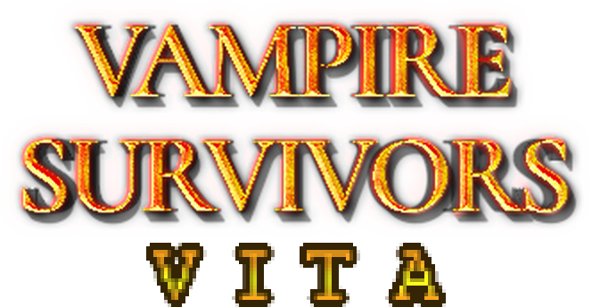  
  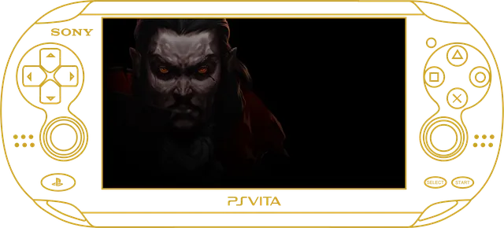

<b>Vampire Survivors</b>, rebuilt natively for the PlayStation Vita.

  
  
   
  
  
  

 

A native PS Vita port of **Vampire Survivors** (poncle, 2022). Not an emulator
and not a wrapper: the Phaser build of the game, the one Steam still ships as
the `old-engine` beta branch, rewritten in C on top of raylib, SDL2 and vitaGL,
logic class by class, so it plays like the original.

Everything is in: all 15 stages, 41 characters, the 76 base weapons with
evolutions and Limit Break, the 22 Arcanas, relics, golden eggs, the shop, the
collection, the bestiary, achievements, Inverse and Hyper modes, the endings
and credits, saves in 30 languages, and both Phaser-era DLCs, Legacy of the
Moonspell and Tides of the Foscari, if you own them. On top of that the port
adds things of its own: **local co-op between two Vitas**, trophies, PC save
import, custom characters, a Jukebox, and an experimental 3D view.

  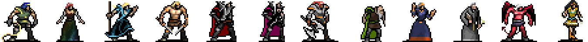

> [!IMPORTANT]
> This repository and its releases do **not** include the game. You need your own
> copy of Vampire Survivors on Steam: the setup tool extracts the data from it.

<a href="#whats-new-in-v121">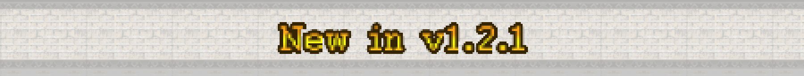</a>

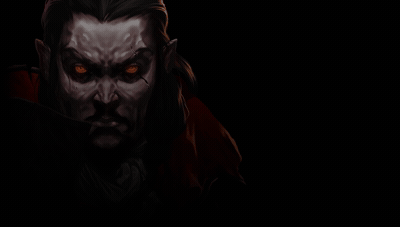

- **Animated boot screen**, frames by Wolff ([WolffsRoom](https://github.com/WolffsRoom)):
  the LiveArea picture stays on screen while the game loads, then comes to
  life and fades into the photosensitivity warning.
- **No more crashes on the DLC stages**: every run reloaded the stage map
  without freeing the old one, and the DLC maps are big enough to run the
  Vita out of memory by the second or third run (#14).
- **Arcana chests give Arcanas again** instead of a gold bag (#15).

Full history in the [Changelog](#changelog).

<a href="#screenshots">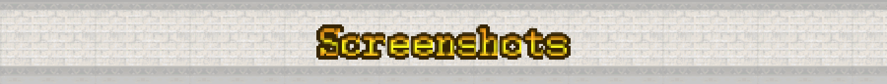</a>

| | |
|---|---|
| 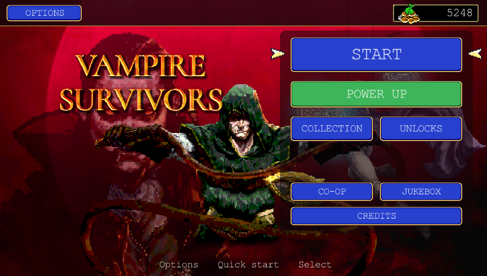 | 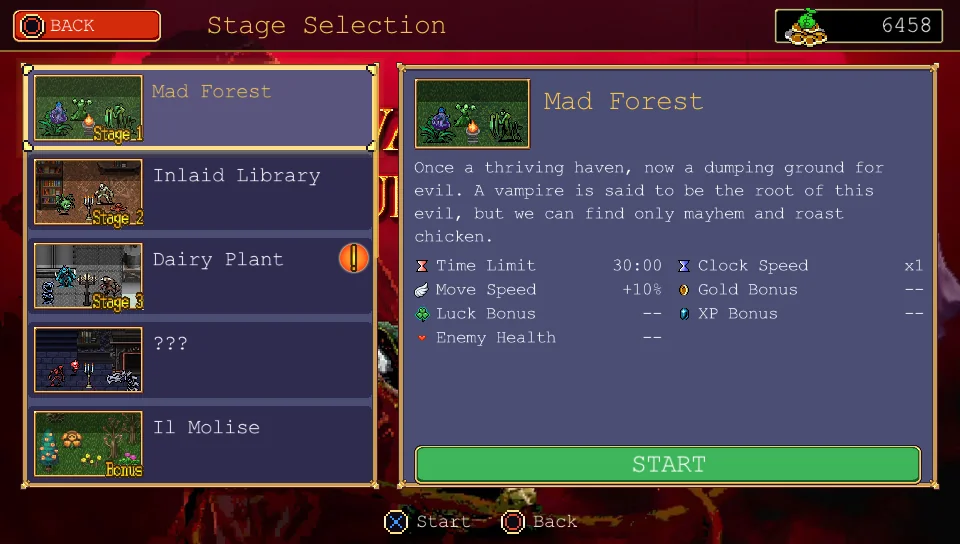 |
|  | 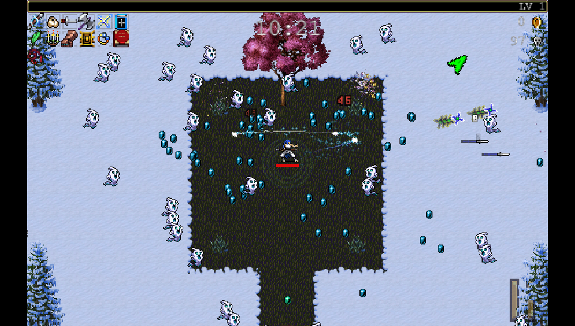 |
| 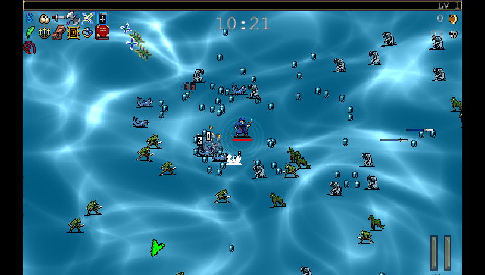 | 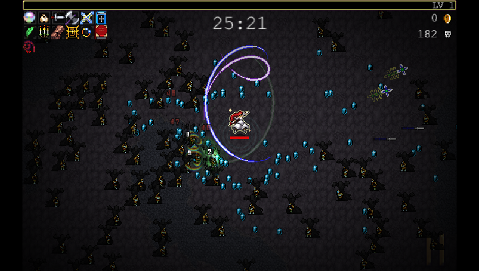 |
| 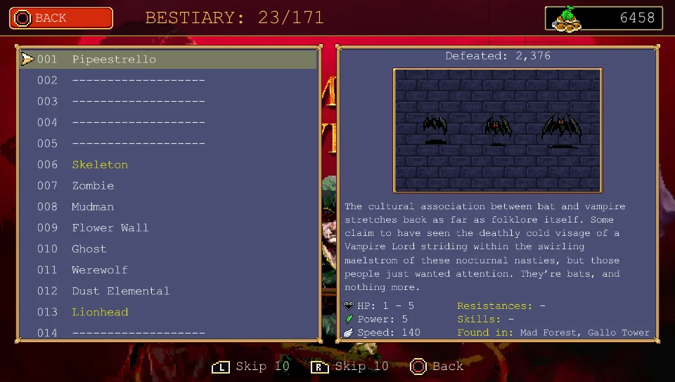 | 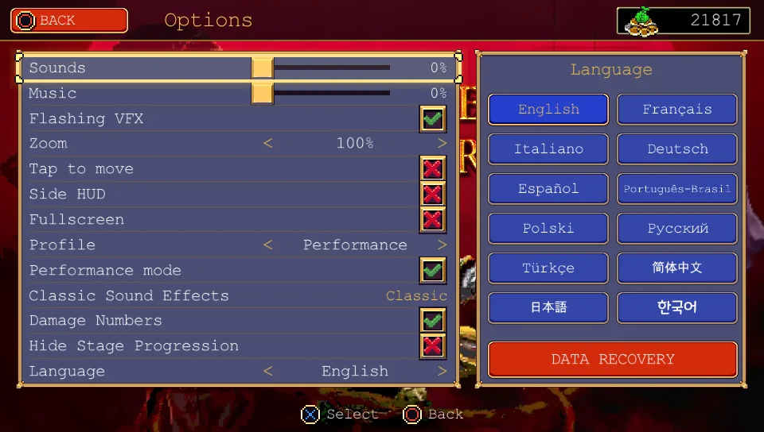 |

*Captured from the desktop preview build, which runs the same game code at the
Vita's 960x544. Frame rate on the real console is covered under Known Issues.*

<a href="#official-game-download">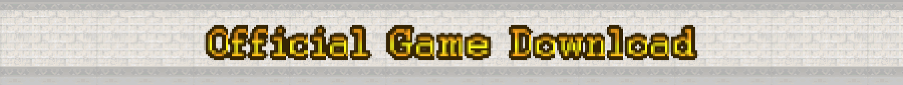</a>

Vampire Survivors is on Steam. **This port does not include the game**: its
graphics, sounds, music and data are not in the VPK. You need your own copy,
and you extract the data from it yourself with the setup tool below. DLCs work
only if you own them: the tool picks up what your copy has. The only
exceptions are the LiveArea images, made from the game's official artwork, the
trophy pack, which carries the achievement texts and icons, the startup intro,
animation from the Ode to Castlevania announcement trailer (poncle / Konami)
set to original music, and the screenshots, recordings, sprites and title
lettering on this page, all taken from the game.

<a href="#setup-instructions-for-end-users">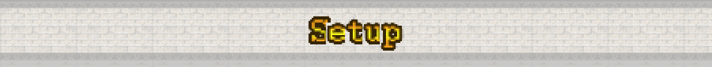</a>

1. **Get the Phaser build.** In Steam, right-click Vampire Survivors,
   Properties, Betas. Enter the access code `PhaserVersion2023`, pick
   `old-engine` and let it download.

2. **Run the setup tool** for your computer (Windows, macOS or Linux / Steam
   Deck; you can find it with each release). It finds your copy of the game on
   its own (Steam, also inside CrossOver/Wine bottles or Flatpak), extracts the
   data and sends it to the Vita:
   - over Wi-Fi: open VitaShell, press SELECT, and type the address it shows;
   - or to a folder / the Vita's memory card in VitaShell's USB mode.

   About 125 MB go to `ux0:data/VampireSurvivors/`, about 165 MB with both
   DLCs. If the connection drops, press Prepare again: it only sends what is
   missing. Nothing needs to be installed on the computer: the tool runs the
   game's own data scripts and re-encodes the three chest videos for the Vita
   by itself.

   From a terminal, the same tool also works without a window:

       python3 tools/vs_setup.py extract "<game folder>" gamedata
       python3 tools/vs_setup.py send "<game folder>" <Vita IP>

   (running it from source needs `pip install quickjs imageio-ffmpeg`).

3. **Install `libshacccg.suprx`** if you have not already (extract it with
   ShaRKBR33D). vitaGL compiles its shaders at runtime and nothing will render
   without it; the tool warns you if it is missing.

4. **Install the VPK** with VitaShell.

**Updating from v1.0:** just install the new VPK. Your save carries over and
the game data does not need to be sent again.

<a href="#co-op">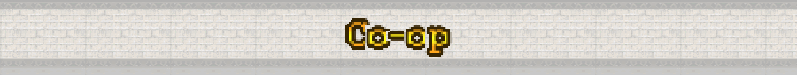</a>

  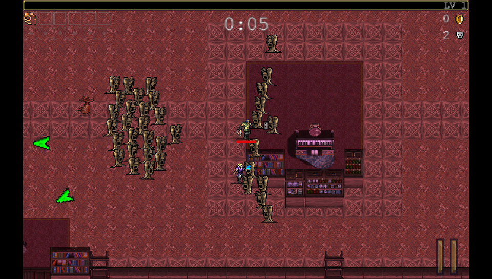

Two players, two Vitas, each with the game and its data installed, both on
v1.1.

1. Connect both Vitas to the same Wi-Fi network.
2. On both, pick **Co-op** in the main menu: one Vita hosts, the other joins.
3. The joining player picks a character among the ones they have bought; the
   host picks the stage.

Each player has their own weapons, level-ups and chests. If one falls, they
come back at the other's next level-up, with half their health.

<a href="#the-funny-glasses-experimental-3d-view">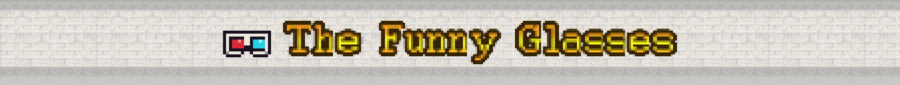</a>

<i>experimental 3D view</i>

  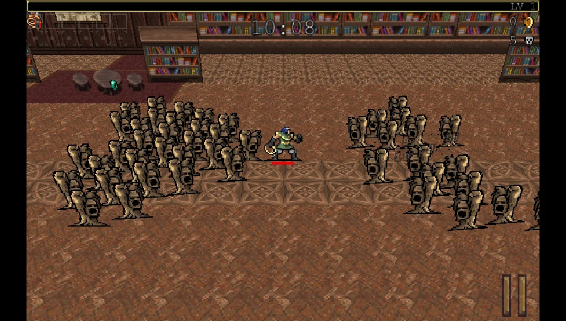
  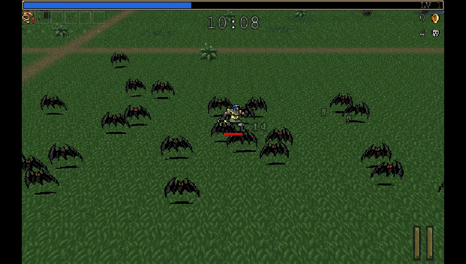

A pair of Funny Glasses is hidden in the Mad Forest. Pick them up for 30
seconds of 3D; after that, a **View** option in the Options switches the 3D
view on for good. It lays the world on a tilted plane with the sprites
standing up, in the spirit of the VS3D mod.

**This is a beta and an easter egg, made for fun rather than to be played
seriously.** The game was never designed for 3D: some props float or overlap,
walls can look odd, ground effects stay flat, and it costs frame rate. Expect
rough edges.

<a href="#jukebox">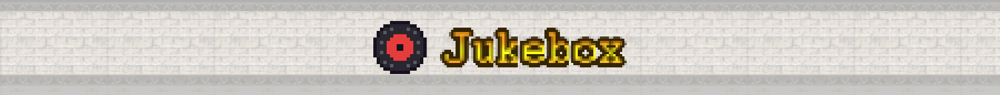</a>

  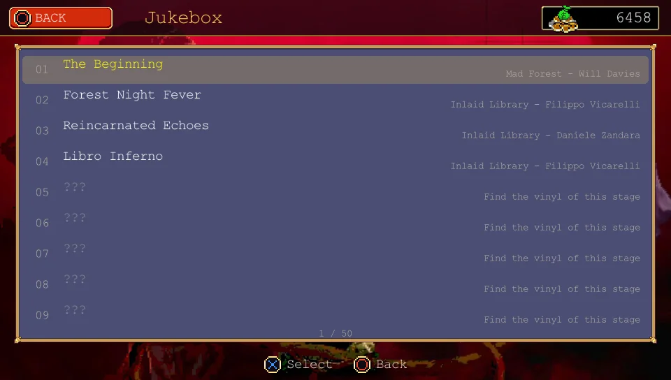

Every stage hides a vinyl record. The first one you find unlocks the
**Jukebox** in the main menu, where you can listen to the stage themes you
have unlocked.

<a href="#custom-characters">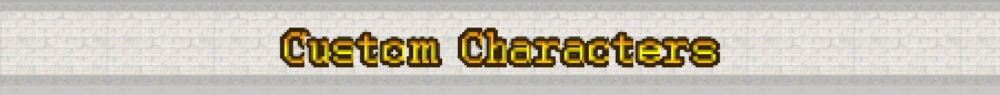</a>

  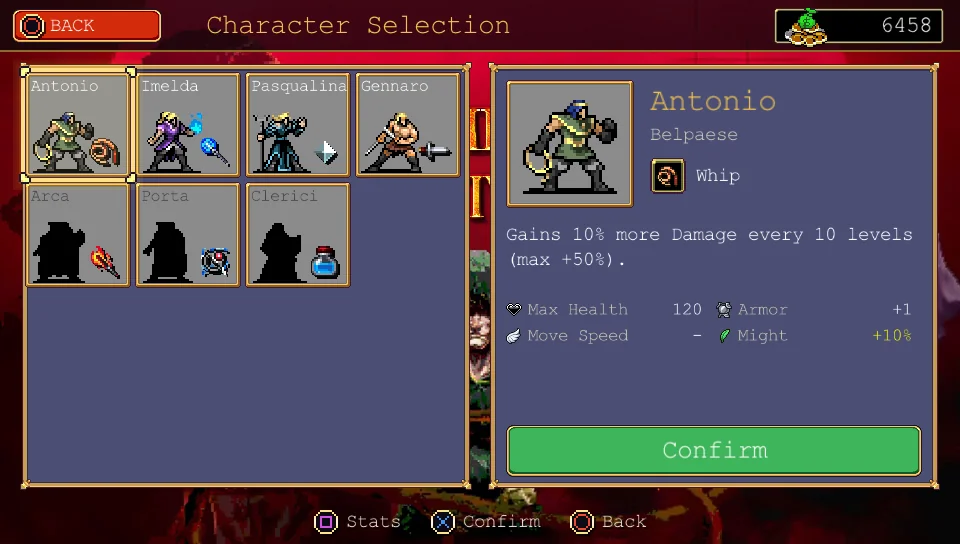

The port loads characters in the format of the Unity version's custom
character beta (as made by Customello). Put each one in its own folder under
`ux0:data/VampireSurvivors/CustomCharacters/`, with its `character.json`,
`localization.json`, `sprites/` and `skins/`, and it shows up in the character
selection. Abilities the Phaser build never had (followers, ability cards,
special controllers) are ignored. In co-op, a custom character the other Vita
does not have falls back to Antonio there.

<a href="#bringing-your-pc-save">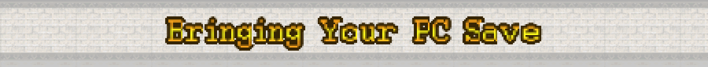</a>

  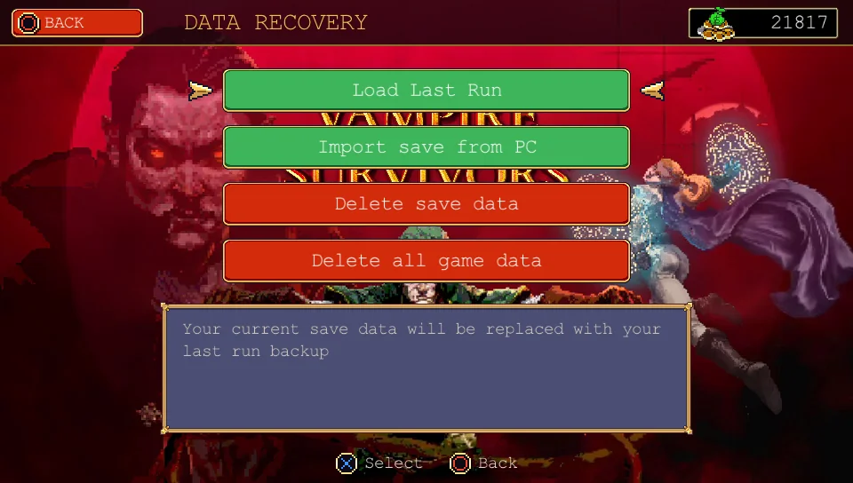

You can carry your progress over from the PC, with both the current Steam
version and old-engine. Content this port does not have is skipped.

1. **Find your save on the computer:**
   - Current Steam version: `Steam/userdata/<id>/1794680/remote/SaveData`
   - Old-engine, `SaveData.sav`:
     - Windows: `%APPDATA%\Vampire_Survivors_<id>`
     - macOS: `~/Library/Application Support/Vampire_Survivors_<id>`
     - Linux: `~/.config/Vampire_Survivors_<id>`
2. **On the Vita**, connected to the same Wi-Fi as the computer: Options, Data
   Recovery, **Import save from PC**. The game shows an address; keep that
   screen open.
3. **On the computer**, open the address in a browser, choose the file and
   press Send.
4. **Back on the Vita**, check the summary and press **Import this save**. The
   game restarts with your progress.

Your previous Vita save stays in `ux0:data/VampireSurvivors/SaveData.preimport`.

<a href="#trophies">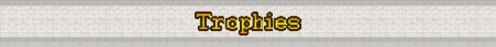</a>

  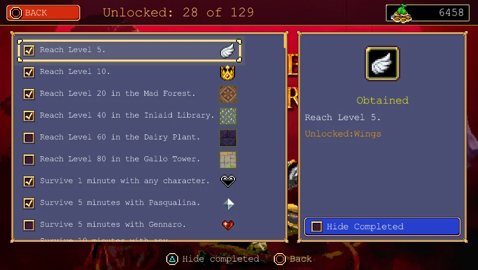
  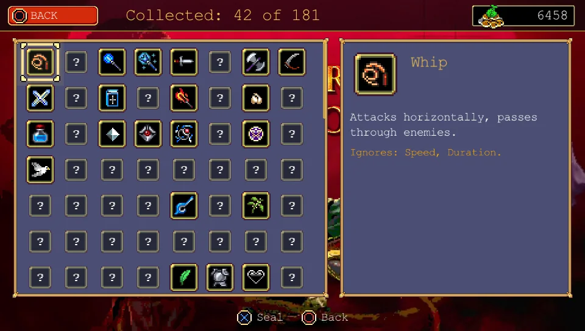

There are 190 trophies plus the platinum, in two sets (the DLC ones are in the
second, and need the DLCs). They need the
[NoTrpDrm](https://github.com/Rinnegatamante/NoTrpDrm) plugin; without it the
game runs normally, just without trophies.

1. Copy `NoTrpDrm.suprx` to `ur0:tai/` with VitaShell.
2. Back up `ur0:tai/config.txt`, then add this line under `*main`:

       ur0:tai/NoTrpDrm.suprx

3. Reboot the Vita and start the game.

Achievements you already have earn their trophies when the game starts,
imported ones included: import your PC save first and they arrive on the
restart.

<a href="#controls">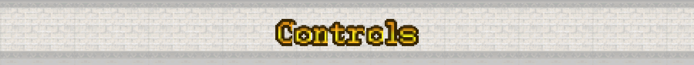</a>

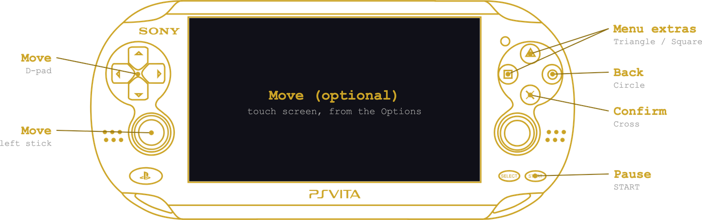 
PS Vita illustration: <a href="https://commons.wikimedia.org/wiki/File:PSV_Layout.svg">Tokyoship</a>, CC BY 3.0, recolored.

| Vita | Game |
|---|---|
| Left stick / D-pad | Move, menu navigation |
| Touch screen | Move (optional, in the Options) |
|  Cross | Confirm |
|  Circle | Back |
|  Start | Pause |
|   Triangle / Square | The extra buttons shown in menus |
|   L / R | Skip ten entries in the bestiary |

<a href="#known-issues">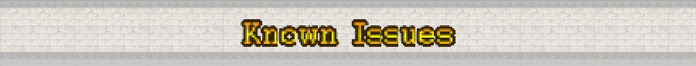</a>

- Very heavy waves (around 300 enemies on screen with the busiest weapons) can
  still dip below 60 fps. Normal play runs at or close to 60 fps, on the DLC
  stages too.
- The 3D view is experimental (see The Funny Glasses): visual glitches and a
  lower frame rate are expected there.

<a href="#not-included">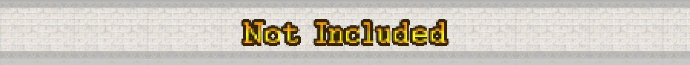</a>

- Online features and anything tied to Steam.
- Later content the Phaser build never had (Emergency Meeting, Ode to
  Castlevania and so on).

<a href="#changelog">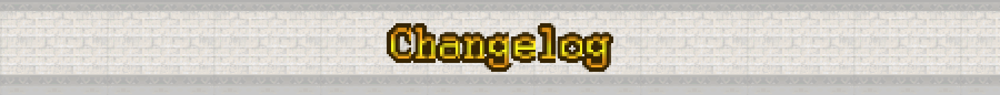</a>

**v1.2.1** - fixes the out-of-memory crash on the DLC stages (#14, thanks to
limonetas for the dump) and Arcana chests that paid out only gold (#15, thanks
to Athos), and adds an animated boot screen with frames by Wolff
([WolffsRoom](https://github.com/WolffsRoom)).

**v1.2** - no more black flashes or half-second freezes in heavy waves, the
game view shown without delay, a Graphics profile that no longer waits on the
GPU, fewer damage numbers in Performance, Fullscreen and Side HUD options,
system trophy notifications, and fixes from the issue tracker: Hurry mode,
Green Acres, Gallo Tower, forgotten port options, Poe and Arca achievements,
the Cappella Magna coffin. Thanks to Benjih ([Benjih77](https://github.com/Benjih77))
and Athos ([AthosSoster](https://github.com/AthosSoster)) for the reports.

**v1.1** - local co-op for two Vitas on the same Wi-Fi, a startup intro, much
smoother heavy waves (around 56 fps where v1.0 dropped to 39) from Marcin ([DrakonPL](https://github.com/DrakonPL))'s performance ideas, custom
characters, a Jukebox with a vinyl hidden in every stage, the experimental 3D
view, and Wolff ([WolffsRoom](https://github.com/WolffsRoom))'s interface ideas: photosensitivity warning, pixel button
glyphs, animated main menu, centered prompts, zoom and touch movement in the
Options. Fixes in the pause screen panels.

**v1.0** - both DLCs (Legacy of the Moonspell, Tides of the Foscari), trophies
(two sets, needs NoTrpDrm), PC save import over Wi-Fi, a rebuilt Data Recovery
screen with save deletion. Fixes: weapons picked up late, evolutions above all,
did no damage once the inventory filled up; crash leaving the credits. New
LiveArea art by Wolff ([WolffsRoom](https://github.com/WolffsRoom)).

**v0.9 beta** - first public release: the whole base game, chest videos in the
final stage played by the Vita's hardware decoder, 60 fps in normal play.

<a href="#building">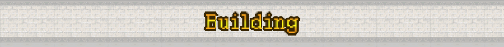</a>

You need [VitaSDK](https://vitasdk.org) with vitaGL, SDL2 and a patched build
of the raylib 5.5 Vita port: `patches/raylib-5.5-vita.patch` (batching and
blend-state fixes for vitaGL, faster textured quads, no MSAA, audio enabled).
The Vita audio backend of that raylib only survives as a compiled object, so
each release also ships the prebuilt `libraylib.a` (raylib is zlib-licensed):
drop it into `$VITASDK/arm-vita-eabi/lib/`.

    ./build_vita.sh          # VPK in build_vita/
    ./build_desktop.sh       # desktop preview on macOS (raylib from Homebrew)

The desktop build reads its data from `$VS_DATA` (default `gamedata/`).

<a href="#credits">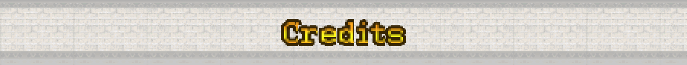</a>

- **poncle** for making Vampire Survivors. Please buy it, you need it anyway
- **Wolff** ([WolffsRoom](https://github.com/WolffsRoom)) for the LiveArea art,
  the animated boot screen, the animated main menu, the button glyphs, a whole list of interface ideas,
  the crash dump behind the credits fix, and the work on trophies this port
  learned from
- **Marcin** ([DrakonPL](https://github.com/DrakonPL)) for the performance work behind v1.1's frame rate: his
  pull request measured where the frame time was going and brought the ideas
  this release is built on (the GPU wait, audio off the main thread,
  incremental sorting, off-screen culling, enemy templates, the projectile
  grid)
- **Richard Davey / Photon Storm** for [Phaser](https://github.com/phaserjs/phaser):
  `src/phaser.c` is a C translation of the parts of Phaser 3.55.2 the game uses
- **Rex** for [phaser3-rex-plugins](https://github.com/rexrainbow/phaser3-rex-plugins)
  (ShatterImage), and **ironwallaby** for delaunay-fast
- **Rinnegatamante** for [vitaGL](https://github.com/Rinnegatamante/vitaGL), the
  [raylib 5.5 Vita port](https://github.com/Rinnegatamante/raylib-5.5-vita) and
  ShaRKBR33D
- **Ramon Santamaria (raysan5)** for [raylib](https://github.com/raysan5/raylib)
- **Northfear** for the [SDL2 Vita port](https://github.com/Northfear/SDL)
- **Dave Gamble and contributors** for [cJSON](https://github.com/DaveGamble/cJSON)
- **The [VitaSDK](https://vitasdk.org) team** for the toolchain, and **TheFloW**
  for VitaShell and the groundwork the Vita homebrew scene rests on
- **Fabrice Bellard and Charlie Gordon** for QuickJS, **PetterS** for its
  [Python bindings](https://github.com/PetterS/quickjs), and the
  **[FFmpeg](https://ffmpeg.org)**,
  **[imageio-ffmpeg](https://github.com/imageio/imageio-ffmpeg)** and
  **[PyInstaller](https://pyinstaller.org)** projects, all used by the setup tool

- **Tokyoship** for the [PS Vita illustration](https://commons.wikimedia.org/wiki/File:PSV_Layout.svg)
  used for the title animation and the control layout on this page
  ([CC BY 3.0](https://creativecommons.org/licenses/by/3.0/), recolored)

Licenses and notices are in `THIRD_PARTY_NOTICES.md`.

<a href="#disclaimer">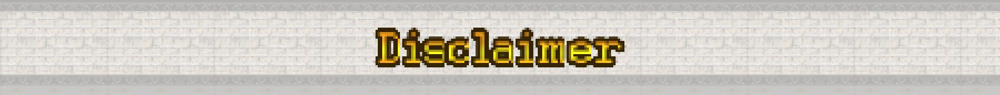</a>

This is an unofficial, non-commercial fan project, not affiliated with or
endorsed by poncle or Konami.

The source code of this port is released under the MIT License (see
`LICENSE`). Vampire Survivors and everything in it belong to poncle; the
game's data is not part of this repository, and the LiveArea images, trophy
pack contents, intro animation and screenshots stay theirs too.
