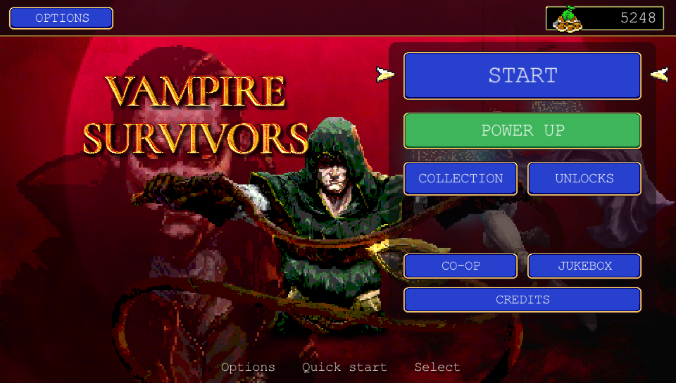
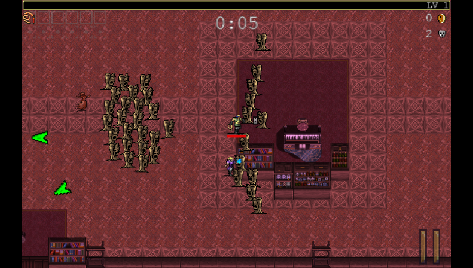
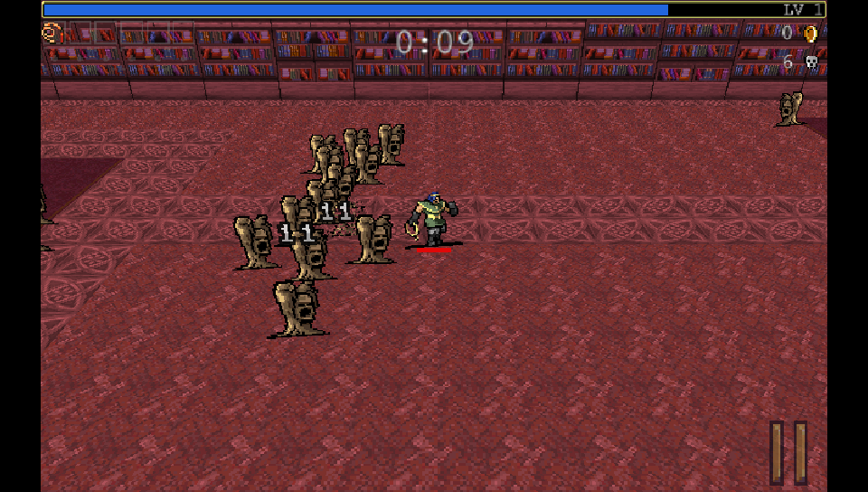
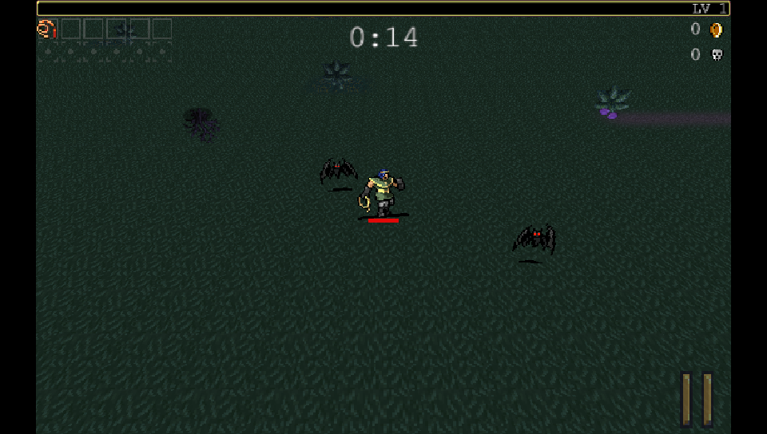
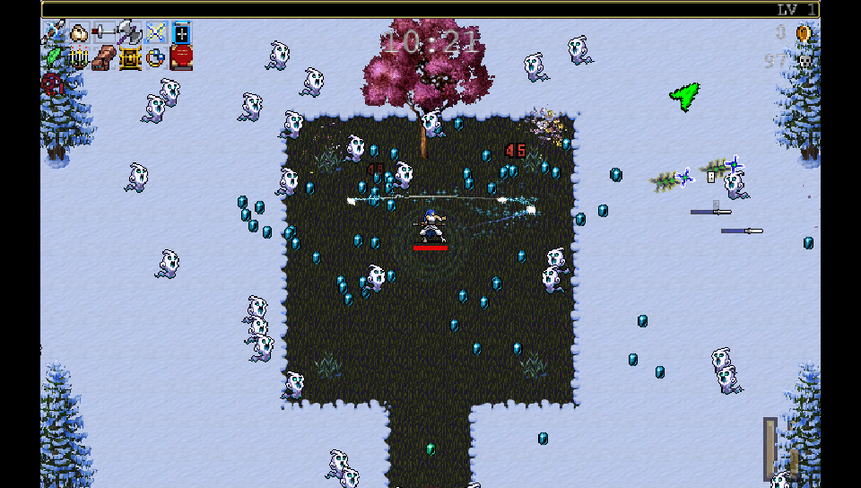
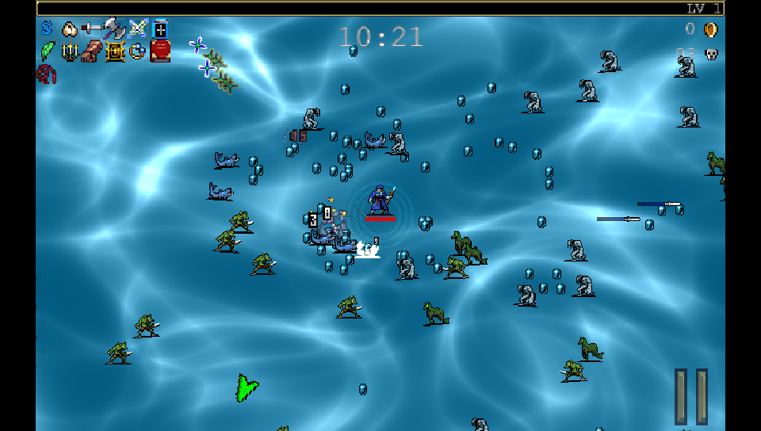
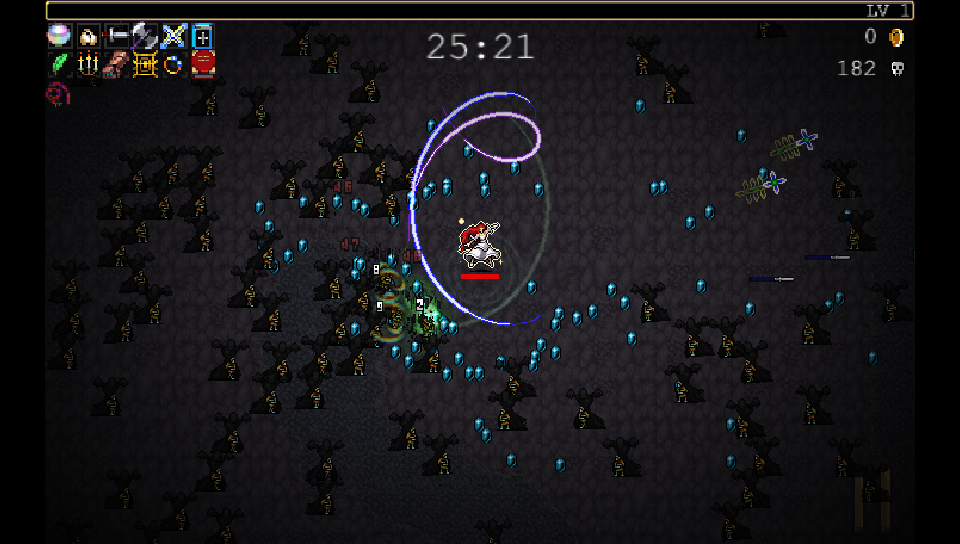

# Vampire Survivors - PS Vita Port

A native PS Vita port of **Vampire Survivors** (poncle, 2022). Not an emulator
and not a wrapper: the Phaser build of the game, the one Steam still ships as
the `old-engine` beta branch, rewritten in C on top of raylib, SDL2 and vitaGL,
logic class by class, so it plays like the original.

Everything is in: all 15 stages, 41 characters, the 76 base weapons with
evolutions and Limit Break, the 22 Arcanas, relics, golden eggs, the shop, the
collection, the bestiary, achievements, Inverse and Hyper modes, the endings
and credits, saves in 30 languages, and both Phaser-era DLCs, Legacy of the
Moonspell and Tides of the Foscari, if you own them. On top of that the port
adds things of its own: **local co-op between two Vitas**, trophies, PC save
import, custom characters, a Jukebox, and an experimental 3D view.

## What's New in v1.2

- **No more black flashes**: the flicker at the bottom of the screen during
  heavy waves is gone, in both profiles. The screen swap was not waiting for
  the vertical blank, so a buffer still on screen could be wiped. Now it
  waits, at no cost in frame rate.
- **No more half-second freezes** the first time a new kind of enemy showed
  up: each stage loads its enemy sheets when it starts.
- **Snappier controls**: the game view is shown in the frame it is drawn.
  v1.1 showed it two frames late to hide the flashes.
- **Profiles that mean what they say**: *Performance*, the default, trims the
  busiest effects (a third of SpellStrom's particles, no more than 166 damage
  numbers on screen); *Graphics* keeps every effect as in the original and no
  longer waits on the GPU every frame. In the heaviest test, around 290
  enemies with six evolved weapons, they hold about 53 and 49 fps.
- **Fullscreen** and **Side HUD** options, outlined HUD text, and system
  trophy notifications instead of the achievements list popping up on the
  results screen. Side HUD and trophy notifications are ideas from Wolff
  ([WolffsRoom](https://github.com/WolffsRoom)).
- **Fixes from your reports**: Hurry mode clock, enemies that stopped spawning
  in Green Acres, the Gallo Tower crash, forgotten port options, Poe's and
  Arca's level 50 achievements, the Cappella Magna coffin.

Full history in the [Changelog](#changelog).

## Screenshots

| | |
|---|---|
|  |  |
|  |  |
|  |  |
|  |  |
|  |  |

*Captured from the desktop preview build, which runs the same game code at the
Vita's 960x544. Frame rate on the real console is covered under Known Issues.*

## Official Game Download

Vampire Survivors is on Steam. **This port does not include the game**: its
graphics, sounds, music and data are not in the VPK. You need your own copy,
and you extract the data from it yourself with the setup tool below. DLCs work
only if you own them: the tool picks up what your copy has. The only
exceptions are the LiveArea images, made from the game's official artwork, the
trophy pack, which carries the achievement texts and icons, the startup intro,
animation from the Ode to Castlevania announcement trailer (poncle / Konami)
set to original music, and the screenshots in this README.

## Setup Instructions For End Users

1. **Get the Phaser build.** In Steam, right-click Vampire Survivors,
   Properties, Betas. Enter the access code `PhaserVersion2023`, pick
   `old-engine` and let it download.

2. **Run the setup tool** for your computer (Windows, macOS or Linux / Steam
   Deck; you can find it with each release). It finds your copy of the game on
   its own (Steam, also inside CrossOver/Wine bottles or Flatpak), extracts the
   data and sends it to the Vita:
   - over Wi-Fi: open VitaShell, press SELECT, and type the address it shows;
   - or to a folder / the Vita's memory card in VitaShell's USB mode.

   About 125 MB go to `ux0:data/VampireSurvivors/`, about 165 MB with both
   DLCs. If the connection drops, press Prepare again: it only sends what is
   missing. Nothing needs to be installed on the computer: the tool runs the
   game's own data scripts and re-encodes the three chest videos for the Vita
   by itself.

   From a terminal, the same tool also works without a window:

       python3 tools/vs_setup.py extract "<game folder>" gamedata
       python3 tools/vs_setup.py send "<game folder>" <Vita IP>

   (running it from source needs `pip install quickjs imageio-ffmpeg`).

3. **Install `libshacccg.suprx`** if you have not already (extract it with
   ShaRKBR33D). vitaGL compiles its shaders at runtime and nothing will render
   without it; the tool warns you if it is missing.

4. **Install the VPK** with VitaShell.

**Updating from v1.0:** just install the new VPK. Your save carries over and
the game data does not need to be sent again.

## Co-op

Two players, two Vitas, each with the game and its data installed, both on
v1.1.

1. Connect both Vitas to the same Wi-Fi network.
2. On both, pick **Co-op** in the main menu: one Vita hosts, the other joins.
3. The joining player picks a character among the ones they have bought; the
   host picks the stage.

Each player has their own weapons, level-ups and chests. If one falls, they
come back at the other's next level-up, with half their health.

## The Funny Glasses (experimental 3D view)

A pair of Funny Glasses is hidden in the Mad Forest. Pick them up for 30
seconds of 3D; after that, a **View** option in the Options switches the 3D
view on for good. It lays the world on a tilted plane with the sprites
standing up, in the spirit of the VS3D mod.

**This is a beta and an easter egg, made for fun rather than to be played
seriously.** The game was never designed for 3D: some props float or overlap,
walls can look odd, ground effects stay flat, and it costs frame rate. Expect
rough edges.

## Jukebox

Every stage hides a vinyl record. The first one you find unlocks the
**Jukebox** in the main menu, where you can listen to the stage themes you
have unlocked.

## Custom Characters

The port loads characters in the format of the Unity version's custom
character beta (as made by Customello). Put each one in its own folder under
`ux0:data/VampireSurvivors/CustomCharacters/`, with its `character.json`,
`localization.json`, `sprites/` and `skins/`, and it shows up in the character
selection. Abilities the Phaser build never had (followers, ability cards,
special controllers) are ignored. In co-op, a custom character the other Vita
does not have falls back to Antonio there.

## Bringing Your PC Save

You can carry your progress over from the PC, with both the current Steam
version and old-engine. Content this port does not have is skipped.

1. **Find your save on the computer:**
   - Current Steam version: `Steam/userdata/<id>/1794680/remote/SaveData`
   - Old-engine, `SaveData.sav`:
     - Windows: `%APPDATA%\Vampire_Survivors_<id>`
     - macOS: `~/Library/Application Support/Vampire_Survivors_<id>`
     - Linux: `~/.config/Vampire_Survivors_<id>`
2. **On the Vita**, connected to the same Wi-Fi as the computer: Options, Data
   Recovery, **Import save from PC**. The game shows an address; keep that
   screen open.
3. **On the computer**, open the address in a browser, choose the file and
   press Send.
4. **Back on the Vita**, check the summary and press **Import this save**. The
   game restarts with your progress.

Your previous Vita save stays in `ux0:data/VampireSurvivors/SaveData.preimport`.

## Trophies

There are 190 trophies plus the platinum, in two sets (the DLC ones are in the
second, and need the DLCs). They need the
[NoTrpDrm](https://github.com/Rinnegatamante/NoTrpDrm) plugin; without it the
game runs normally, just without trophies.

1. Copy `NoTrpDrm.suprx` to `ur0:tai/` with VitaShell.
2. Back up `ur0:tai/config.txt`, then add this line under `*main`:

       ur0:tai/NoTrpDrm.suprx

3. Reboot the Vita and start the game.

Achievements you already have earn their trophies when the game starts,
imported ones included: import your PC save first and they arrive on the
restart.

## Controls

| Vita | Game |
|---|---|
| Left stick / D-pad | Move, menu navigation |
| Touch screen | Move (optional, in the Options) |
| Cross | Confirm |
| Circle | Back |
| Start | Pause |
| Triangle / Square | The extra buttons shown in menus |

## Known Issues

- Very heavy waves (around 300 enemies on screen with the busiest weapons) can
  still dip below 60 fps. Normal play runs at or close to 60 fps, on the DLC
  stages too.
- The 3D view is experimental (see The Funny Glasses): visual glitches and a
  lower frame rate are expected there.

## Not Included

- Online features and anything tied to Steam.
- Later content the Phaser build never had (Emergency Meeting, Ode to
  Castlevania and so on).

## Changelog

**v1.2** - no more black flashes or half-second freezes in heavy waves, the
game view shown without delay, a Graphics profile that no longer waits on the
GPU, fewer damage numbers in Performance, Fullscreen and Side HUD options,
system trophy notifications, and fixes from the issue tracker: Hurry mode,
Green Acres, Gallo Tower, forgotten port options, Poe and Arca achievements,
the Cappella Magna coffin. Thanks to Benjih ([Benjih77](https://github.com/Benjih77))
and Athos ([AthosSoster](https://github.com/AthosSoster)) for the reports.

**v1.1** - local co-op for two Vitas on the same Wi-Fi, a startup intro, much
smoother heavy waves (around 56 fps where v1.0 dropped to 39) from Marcin ([DrakonPL](https://github.com/DrakonPL))'s performance ideas, custom
characters, a Jukebox with a vinyl hidden in every stage, the experimental 3D
view, and Wolff ([WolffsRoom](https://github.com/WolffsRoom))'s interface ideas: photosensitivity warning, pixel button
glyphs, animated main menu, centered prompts, zoom and touch movement in the
Options. Fixes in the pause screen panels.

**v1.0** - both DLCs (Legacy of the Moonspell, Tides of the Foscari), trophies
(two sets, needs NoTrpDrm), PC save import over Wi-Fi, a rebuilt Data Recovery
screen with save deletion. Fixes: weapons picked up late, evolutions above all,
did no damage once the inventory filled up; crash leaving the credits. New
LiveArea art by Wolff ([WolffsRoom](https://github.com/WolffsRoom)).

**v0.9 beta** - first public release: the whole base game, chest videos in the
final stage played by the Vita's hardware decoder, 60 fps in normal play.

## Building

You need [VitaSDK](https://vitasdk.org) with vitaGL, SDL2 and a patched build
of the raylib 5.5 Vita port: `patches/raylib-5.5-vita.patch` (batching and
blend-state fixes for vitaGL, faster textured quads, no MSAA, audio enabled).
The Vita audio backend of that raylib only survives as a compiled object, so
each release also ships the prebuilt `libraylib.a` (raylib is zlib-licensed):
drop it into `$VITASDK/arm-vita-eabi/lib/`.

    ./build_vita.sh          # VPK in build_vita/
    ./build_desktop.sh       # desktop preview on macOS (raylib from Homebrew)

The desktop build reads its data from `$VS_DATA` (default `gamedata/`).

## Credits

- **poncle** for making Vampire Survivors. Please buy it, you need it anyway
- **Wolff** ([WolffsRoom](https://github.com/WolffsRoom)) for the LiveArea art,
  the animated main menu, the button glyphs, a whole list of interface ideas,
  the crash dump behind the credits fix, and the work on trophies this port
  learned from
- **Marcin** ([DrakonPL](https://github.com/DrakonPL)) for the performance work behind v1.1's frame rate: his
  pull request measured where the frame time was going and brought the ideas
  this release is built on (the GPU wait, audio off the main thread,
  incremental sorting, off-screen culling, enemy templates, the projectile
  grid)
- **Richard Davey / Photon Storm** for [Phaser](https://github.com/phaserjs/phaser):
  `src/phaser.c` is a C translation of the parts of Phaser 3.55.2 the game uses
- **Rex** for [phaser3-rex-plugins](https://github.com/rexrainbow/phaser3-rex-plugins)
  (ShatterImage), and **ironwallaby** for delaunay-fast
- **Rinnegatamante** for [vitaGL](https://github.com/Rinnegatamante/vitaGL), the
  [raylib 5.5 Vita port](https://github.com/Rinnegatamante/raylib-5.5-vita) and
  ShaRKBR33D
- **Ramon Santamaria (raysan5)** for [raylib](https://github.com/raysan5/raylib)
- **Northfear** for the [SDL2 Vita port](https://github.com/Northfear/SDL)
- **Dave Gamble and contributors** for [cJSON](https://github.com/DaveGamble/cJSON)
- **The [VitaSDK](https://vitasdk.org) team** for the toolchain, and **TheFloW**
  for VitaShell and the groundwork the Vita homebrew scene rests on
- **Fabrice Bellard and Charlie Gordon** for QuickJS, **PetterS** for its
  [Python bindings](https://github.com/PetterS/quickjs), and the
  **[FFmpeg](https://ffmpeg.org)**,
  **[imageio-ffmpeg](https://github.com/imageio/imageio-ffmpeg)** and
  **[PyInstaller](https://pyinstaller.org)** projects, all used by the setup tool

Licenses and notices are in `THIRD_PARTY_NOTICES.md`.

## Disclaimer

This is an unofficial, non-commercial fan project, not affiliated with or
endorsed by poncle or Konami.

## License

The source code of this port is released under the MIT License (see
`LICENSE`). Vampire Survivors and everything in it belong to poncle; the
game's data is not part of this repository, and the LiveArea images, trophy
pack contents, intro animation and screenshots stay theirs too.
